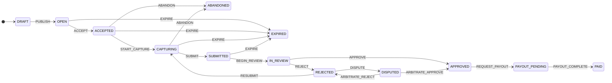

# dataquest-task-lifecycle

Task lifecycle state machine for a two-sided human-data marketplace,
reproduced from the **DataQuest** portfolio case study (human-action data
marketplace for embodied AI). Covers the full path from task creation to
payout, plus the edge cases the case study calls out: **abandonment**,
**expiration**, and **dispute resolution**.

TypeScript, zero runtime dependencies.

## Install

Node.js ≥ 20.

```bash
npm install
npm run build
npm test   # 546 tests, all local
```

Prefer the demo: `npm run demo` builds, then runs `dist/src/demo.js` — one task
through the full `DRAFT → PAID` chain, including a first submission that is
rejected in QA and resubmitted (the demo sets `maxResubmits: 2` and uses 1 of
the 2; the library default is unlimited) before passing on re-review, with
the append-only audit history printed to stdout, an audit hash-chain
segment that runs `verifyHistoryChain` on that history — the intact
12-entry chain passes, a detached copy whose `PAYOUT_COMPLETE`
entry's `payoutAmount` is altered by 1 is detected (`false`: the
stored hash no longer recomputes), and the original history
re-verifies untouched — the verify-before-replay check an auditor
runs before trusting a persisted history, then a second task running
the SLA watchdog branch (its ACCEPTED-state deadline is already past at a
fixed screening instant, `expiredTasks()` finds it while it is still
ACCEPTED — the deadline alone never expires a task — and a watchdog
explicitly dispatches `EXPIRE` into the EXPIRED terminal state; every
branch timestamp is a fixed literal or the injected screening `now`), then
a third task running the DISPUTE appeal branch (rejected in QA, the
contributor DISPUTEs the rejection into DISPUTED, and a moderator's
ARBITRATE_REJECT lands it back in REJECTED — not a terminal state; the demo
sets `maxDisputes: 1` and uses 1 of the 1, while the library default is
unlimited; every branch timestamp is a fixed literal), and finally the
signed payout webhook for the settled task built from that history and
verified with the demo secret, a receiver-side dedupe segment that
feeds the webhook's `eventId` through a `PayoutEventDedupe` under an
injected fixed clock (the first delivery is booked, a redelivery of
the same `eventId` is skipped as a duplicate, and the same id is
accepted again once the demo TTL — 60 seconds, against the library
default of one hour — lapses at exactly its boundary), a batch
segment that runs `buildPayoutWebhooks` over all three demo tasks
under one shared fixed `now` and a deterministic `eventId` factory (the PAID task builds and
verifies; each non-PAID task lands as `{ taskId, error }` only and
never blocks the tasks after it), a fan-out delivery segment
that delivers the main task's payout event with
`deliverPayoutWebhookToMany` to three fixed endpoints through an
injected fake fetch (zero real network) under one shared fixed
`eventId` and `now`, each endpoint signed with its own demo
secret — the endpoint scripted to answer 500 exhausts its
retries and fails without blocking the other two, and the
per-endpoint results print in input order — a Retry-After parsing
segment that runs `parsePayoutRetryAfter` over a fixed 6-value
corpus under the fan-out segment's shared fixed instant reused
as `nowMs` (delay-seconds `"2"` → 2000 ms and `"  30 "` → 30000 ms,
a future HTTP-date → 5000 ms, a past HTTP-date → 0 ms, and
`"banana"` / absent values → `undefined`, the fallback to
exponential backoff — the hint a 429 response, unlike the risk
endpoint's 500, would have used to set the next retry delay) —
and a final reconciliation
screening branch that drives two more tasks to PAID under
fixed-literal timestamps — one settled with no `payoutRef` on its
`PAYOUT_COMPLETE` entry, one settled for less than its `ACCEPT`
quote — and screens all five demo tasks with
`unreconciledPayouts()` / `mismatchedPayouts()` / `totalPaidOut()`:
each flawed task is flagged by exactly one screen and the paid-out
total is the hand-computed 16349, a dispatch subscription branch
that subscribes a collecting listener to a sixth task under
fixed-literal timestamps — the listener receives the first three
dispatches in order, each `(event, from, to)` matching the audit
history entry with the same seq, and receives nothing for a
fourth dispatch after unsubscribe, a stale-task dwell screening
branch that drives three more tasks under fixed-literal timestamps
to one fixed screening `now` — one sat in OPEN for 21 days, past
its 7-day dwell budget, but its SLA deadline is still ahead; one
sat in IN_REVIEW for 1 day, within its 5-day dwell budget, but its
SLA deadline has passed; and one sat in OPEN for 1 day with no SLA
deadline at all — and prints each task's dwell beside its budget
plus the two screens' subsets side by side: `staleTasks()` selects
only the first task and `expiredTasks()` only the second, so the
same batch reads differently under the dwell lens than under the
deadline lens (both screens are pure; no task is dispatched or
mutated), a stale-task batch execution branch that runs
`actOnStaleTasks()` over four more tasks at the same fixed `now`
under 7-day dwell budgets for ACCEPTED / CAPTURING / SUBMITTED —
the stale task stuck in SUBMITTED (a state with no ABANDON edge)
is placed first and fails in isolation, left untouched, while the
stale ACCEPTED and CAPTURING tasks after it are still abandoned
and a fresh ACCEPTED task is never attempted (3 attempted,
2 acted, 1 failed), an SLA watchdog batch execution branch that
rebuilds the SLA screening batch fresh from the same fixed
literals under the very same fixed screening `now` (the executor
mutates its inputs and the original SLA tasks are already
settled) and runs `expireOverdueTasks()` over the rebuilt batch —
the ACCEPTED mirror of the SLA branch's task and an OPEN task are
both overdue and both expired, a third ACCEPTED task whose
deadline is still ahead produces no result entry and is never
attempted, and the printed screening subset equals the
execution's acted set (2 attempted, 2 expired, 0 failed; the
executor's own EXPIRE audit entries carry the library-default
wall-clock timestamp, which the segment never prints, so its
printed lines are byte-deterministic) — and a closing event-sourcing
segment that exports the main task's audit history with
`historyToNdjson()`, prints all 12 NDJSON lines, parses them back
with `historyFromNdjson()`, and replays them with
`TaskLifecycle.fromHistory()`: the replayed task lands in the same
PAID state with the same 12-entry history, last entry included (the
segment adds no new nondeterminism — it only serializes the main
task's existing history) — and a closing allowed-events listing
segment that runs `allowedEvents()` over all 13 states in
transition-table order and prints one line per state — the query
a task-list UI or a watchdog consults to decide what a task can
do next — with the three terminal states (PAID / ABANDONED /
EXPIRED) returning the empty list, and the main task's own PAID
state called out on its own line as that same empty set — and a
closing standalone history parsing segment that parses a fixed
JSON text with `parseHistory()` alone (no `TaskLifecycle`
instance involved): the text carries the same five-entry
PUBLISH..BEGIN_REVIEW chain that opens the main task, in
hashless legacy form with fixed timestamps, the parsed entries
print one line each, a comparison line confirms the parsed
seq/event/from/to chain equals the main task history's first
five entries, and a detached copy whose third entry's `from`
is rewritten is rejected with the chain-break error on one
closing line (asserted outside the printed parse) — and a
closing transition-table JSON export segment that runs
`transitionTableJson()` and prints an export summary for
front-end / docs tooling: the 19-edge total plus the first
edge (DRAFT --PUBLISH--> OPEN), the payout edge at index 14
(PAYOUT_PENDING --PAYOUT_COMPLETE--> PAID), and the last edge
(DISPUTED --ARBITRATE_REJECT--> REJECTED) parsed back from
the canonical JSON, with the per-edge `from, event, to` key
order confirmed on every edge (the demo tests cross-check the
full parsed edge list against the committed transition-table
snapshot) — and a closing state diagram generation segment
that runs `stateDiagram()` and prints a generation summary:
the 24-line total and 19-edge count plus the first, second,
initial, first-edge, last-edge, and last lines (the demo tests
cross-check the full generated block line by line against
hand-written expectations and the copy embedded above) — and
a closing README diagram sync check segment that runs
`readmeDiagramInSync()` (imported directly from
`src/diagram.ts`, as the benchmark does) and prints its
verdict: `true`, the README embeds the exact generated block
with no diagram drift, asserted outside the printed verdict
against the hand-pinned expectation and cross-checked
against the diagram tests (the only file read is this
README; no network, no randomness, and no wall clock) — and
a closing JSON snapshot round-trip segment that exports the
main task with `toJSON()`, prints the serialized byte count
of the `JSON.stringify` snapshot text, restores the task
with `TaskLifecycle.fromJSON()`, and confirms the
persistence round-trip: state and the full 12-entry history
match the original entry for entry, the used RESUBMIT count
reads 1 of the stored budget of 2 on both sides (the count
is derived from the history, never stored), and
re-exporting the restored task yields the identical
snapshot content at the same serialized length (the
round-trip is a fixed point; `fromJSON` normalizes
history-entry key order, values and hashes unchanged), all
asserted outside the printed lines — and a closing
single-task payout reconciliation detail segment that calls
`payoutMismatch()` on the reconciliation branch's two
settled tasks one at a time: the mismatched task prints its
full detail `{ quoted: 4000, paid: 3750.5, delta: -249.5 }`
(underpaid by 249.5), and the task that settled exactly as
quoted (2500 against 2500) prints the no-mismatch form,
`undefined` — the per-task follow-up finance runs after the
batch `mismatchedPayouts()` screen flags a task, asserted
outside the printed lines against the hand-pinned amounts —
and a closing snapshot version envelope segment that prints
the main task snapshot's `v` field and asserts it equals the
imported `SNAPSHOT_VERSION` (1), retags a detached copy to
`v: 2` and prints the `TaskLifecycle.fromJSON()` rejection
(`invalid snapshot: unsupported snapshot version 2` — a
future format is refused, not silently misread), and reads
the original snapshot back to show it still restores
DEMO-001 in PAID — the version gate a document store relies
on when a snapshot format evolves, asserted outside the
printed lines against the hand-pinned version and error —
and a closing note length limit segment that drives a
dedicated task (DEMO-017) under fixed timestamps: a dispatch
whose note is exactly `MAX_NOTE_LENGTH` (32768) characters
succeeds and stores a note of that length (only the length
is printed, never the note itself), and a following dispatch
whose note is one character over (32769) is rejected with
`invalid dispatch options: note must be at most 32768
characters, got 32769`, leaving the task still in OPEN with
its single history entry untouched — the audit-history
anti-bloat guard a reader would otherwise never see,
asserted outside the printed lines against the hand-pinned
limit and error text (cross-checked against the dispatch
source and the actor/note hardening tests) — and a closing
standalone overdue judgement segment that calls
`isOverdue(task, now)` on three dedicated tasks
(DEMO-018 with an ACCEPTED-state deadline, DEMO-019 with
no deadline, and DEMO-020 ABANDONED with an ABANDONED-state
deadline) at fixed instants and prints its five boundary
verdicts: before the deadline `false`, exactly at the
deadline `true` (the boundary is inclusive), after the
deadline `true`, the no-deadline task `false`, and the
terminal task past its deadline `false` — the advisory
SLA judgement itself, asserted outside the printed lines
against the hand-pinned verdicts (cross-checked against
the `isOverdue` source and the SLA tests) — and a closing
terminal-state judgement segment that calls the standalone
`isTerminal(state)` over all 13 states in transition-table
order and prints every verdict with that state's
outgoing-edge count: only PAID / ABANDONED / EXPIRED are
terminal (3 of 13), and the segment cross-checks the
printed set against the transition table itself — it is
exactly the set of states with no outgoing edges in
`transitionTable()` — with the main task's PAID state
called out as terminal under both the standalone function
and the instance getter, all asserted outside the printed
lines against the hand-pinned verdicts (cross-checked
against the `TERMINAL` set in the source and the
`isTerminal` tests; the branches above only ever showed
the getter as a `(terminal: …)` aside) — and a closing
SLA deadline clearing segment that drives a dedicated
task (DEMO-021) in ACCEPTED carrying fixed deadlines for
ACCEPTED, CAPTURING, and SUBMITTED, overdue at a fixed
instant: `clearSlaDeadline("ACCEPTED")` clears only that
state (its read-back is `undefined` and the overdue
verdict turns `false`, the other states untouched), and
`clearSlaDeadline()` with no argument then clears every
remaining deadline — the renegotiated / cancelled
deadline revocation, asserted outside the printed lines
against the hand-pinned deadlines and verdicts
(cross-checked against the `clearSlaDeadline` source and
the SLA tests).

The package entry point is declared in `package.json` via an `exports` map
(`.` → `dist/src/index.js`, types `dist/src/index.d.ts`); `main`/`types` are
kept pointing at the same files for older resolvers.

## Quickstart

```ts
import { TaskLifecycle } from "./dist/src/index.js";

const task = new TaskLifecycle("task-042");
task.dispatch("PUBLISH", { actor: "researcher" });
task.dispatch("ACCEPT", { actor: "contributor" });
task.dispatch("START_CAPTURE", { actor: "contributor" });
task.dispatch("SUBMIT", { actor: "contributor" });
task.dispatch("BEGIN_REVIEW", { actor: "reviewer" });
task.dispatch("APPROVE", { actor: "reviewer", note: "meets rubric" });
task.dispatch("REQUEST_PAYOUT", { actor: "contributor" });
task.dispatch("PAYOUT_COMPLETE", { actor: "system" });
console.log(task.state); // PAID
```

## State machine

The diagram below is generated from the `transitionTable()` single source of
truth — regenerate it any time with `npm run diagram` (prints the block to
stdout; `node dist/src/diagram.js --check` exits 1 if the README copy
drifts; `--write <file>` writes bare mermaid source for standalone `.mmd`
use). `test/stateDiagram.test.ts` and `test/diagram.test.ts` fail the build
if the README copy or any rendered edge ever drifts from `transition()`
behavior.



- `transition(state, event)` is a pure function; invalid transitions throw.
- `TaskLifecycle` wraps it with an append-only history: each entry has
  (seq, event, from → to, ISO timestamp), optional (actor, note,
  payoutRef, payoutAmount), and a `prevHash`/`hash` SHA-256 audit chain.
- `allowedEvents(state)` / `isTerminal(state)` helpers for UI gating.
- Terminal states: `PAID`, `ABANDONED`, `EXPIRED`.
- `transitionTableJson()` exports the whole transition table as canonical
  JSON; `test/__snapshots__/transitionTable.snapshot.json` is the committed
  snapshot (`test/transitionSnapshot.test.ts` fails if the table ever
  changes without regenerating it).

## SLA deadlines

A state may carry an optional SLA deadline (`TaskLifecycle.setSlaDeadline`,
per-state, stored as normalized ISO). `isOverdue(task, now)` answers
"is the task past its deadline right now" — `false` when no deadline is
set, `false` in terminal states, and true at/after the deadline.

Relationship to `EXPIRE`: the deadline is **advisory only** and never moves
the task by itself — there is no timer, no background scheduler. Expiry
stays an explicit `EXPIRE` event so it lands in the append-only history. The
intended wiring is a watchdog (cron, queue consumer) that polls
`isOverdue()` and dispatches `EXPIRE` itself, which is exactly what
`test/sla.test.ts` demonstrates in its last case.

For batch polling there is a dedicated helper — `expiredTasks(tasks, now)`
returns the "non-terminal and past deadline" subset of a task list. It is a
pure filter (it never mutates or dispatches); the watchdog executor
`expireOverdueTasks(tasks, now)` does the dispatch for you, one line:

```ts
import { expireOverdueTasks, TaskLifecycle } from "./src/index.js";

const tasks: TaskLifecycle[] = loadTasks(); // your store
const outcomes = expireOverdueTasks(tasks); // [{ task, expired: true }, …]
// { task, expired: false, error } — see below
```

Why the executor exists instead of a hand-written loop: `expiredTasks()`
only checks the deadline and the terminal flag, but `EXPIRE` is **not** a
legal event from every non-terminal state — the transition table only has
`EXPIRE` edges on OPEN, ACCEPTED, CAPTURING and SUBMITTED. An overdue
IN_REVIEW task (or a deadline set on any other state without the edge)
makes `task.dispatch("EXPIRE")` throw
`invalid transition: EXPIRE from IN_REVIEW`, aborting a naive
`for (const task of expiredTasks(tasks)) task.dispatch("EXPIRE")` loop on
the first such task. `expireOverdueTasks` catches that error per task —
`{ task, expired: false, error: <message> }` — and keeps going, so one
unexpirable task never blocks the rest of the batch. Only overdue
(non-terminal, past deadline) tasks are attempted; nothing auto-migrates,
every expiry is an explicit dispatch that lands in the append-only
history.

A related but distinct screening is `staleTasks(tasks, maxAgeByState, now)`
— it finds tasks stuck in their *current* non-terminal state longer than a
per-state budget, measured from the last history entry's timestamp. That is
the watchdog for "nobody picked up this OPEN task in a month" or "this
review has been pending a week", as opposed to "this task passed an absolute
deadline". Terminal states and states with no configured budget are never
selected; the helper is pure (never mutates or dispatches), and invalid
budget configuration fails fast with `invalid maxAgeByState: …`:

```ts
import { staleTasks, TaskLifecycle } from "./src/index.js";

const tasks: TaskLifecycle[] = loadTasks(); // your store
const stale = staleTasks(tasks, {
  IN_REVIEW: 7 * 24 * 3600_000, // a week
  OPEN: 30 * 24 * 3600_000,    // a month
});
```

For acting on that list there is a dedicated executor —
`actOnStaleTasks(tasks, action, maxAgeByState, now)` — which runs an
action per stale task and reports `{ task, acted, error? }` per task:

```ts
import { actOnStaleTasks, TaskLifecycle } from "./src/index.js";

const tasks: TaskLifecycle[] = loadTasks(); // your store
const budgets = {
  IN_REVIEW: 7 * 24 * 3600_000, // a week
  OPEN: 30 * 24 * 3600_000,    // a month
};
// action omitted (undefined): the default dispatch("ABANDON", { actor: "system" })
const outcomes = actOnStaleTasks(tasks, undefined, budgets);
// or a custom action, e.g. notify-only paging that never transitions:
// const outcomes = actOnStaleTasks(tasks, (t) => pageOnCall(t.id), budgets);
```

Why the executor exists instead of a hand-written loop: `ABANDON` is
**not** a legal event from every non-terminal state — the transition
table only has `ABANDON` edges on ACCEPTED and CAPTURING. A stale
SUBMITTED, IN_REVIEW or OPEN task makes
`task.dispatch("ABANDON", …)` throw
`invalid transition: ABANDON from SUBMITTED`, aborting a naive
`for (const task of stale) task.dispatch("ABANDON", …)` loop on the
first such task and leaving the rest of the batch unprocessed.
`actOnStaleTasks` catches that error per task —
`{ task, acted: false, error: <message> }` — and keeps going.
Configuration (`maxAgeByState`, `now`, a non-function `action`) is
validated fail-fast before any action runs. The hand-written loop
remains the clearest statement of the semantics:

```ts
for (const task of stale) {
  task.dispatch("ABANDON", { actor: "system" }); // or page a human, not expire
}
```

## Persistence

A task can be exported to plain JSON and rebuilt later — no database
built in, you choose the store:

```ts
const task = new TaskLifecycle("task-042");
task.dispatch("PUBLISH", { actor: "researcher" });
task.setSlaDeadline("2026-12-01T00:00:00.000Z"); // advisory SLA deadline

// snapshot: { v, id, state, history, slaDeadlines, [maxResubmits],
//   [maxDisputes], [rolePolicy], [idempotencyKeys] } — plain JSON, no Maps, no class
//   instances. The bracketed fields appear only when the corresponding
//   option is configured (see TaskSnapshot). Also what
//   JSON.stringify(task) produces.
const snapshot = task.toJSON();
await db.save(snapshot);

// restore later, in another process:
const restored = TaskLifecycle.fromJSON(await db.load("task-042"));
restored.dispatch("ACCEPT"); // history continues at seq 3, no gaps
```

`TaskLifecycle.fromJSON()` is defensive by design: it validates the
untrusted snapshot against the same audit invariants the tests enforce —
seq restarts at 1 with no gaps, the from/to chain is continuous and starts
at `DRAFT`, every `(from, event) → to` edge is a legal transition, and
timestamps are canonical ISO-8601 and non-decreasing. SLA deadline strings
are normalized exactly like `setSlaDeadline` does. Malformed or
inconsistent input throws a specific `invalid snapshot: …` error instead
of producing a task with a broken audit trail. See
`test/serialization.test.ts` for the full checklist.

Snapshots carry a schema version: `toJSON()` always writes `v: 1` (the
exported `SNAPSHOT_VERSION` constant), and `fromJSON()` checks it before
any structural or hash-chain validation. A snapshot with no `v` is a
legacy pre-versioning snapshot and is still accepted, with state,
history, and SLA deadlines restored exactly as before; a snapshot
carrying any other `v` value (`2`, `"1"`, `null`, …) throws
`invalid snapshot: unsupported snapshot version …`, so a future format
change stays distinguishable from corruption. The parser is also
fail-closed about unknown fields, exactly like the sibling
`escrow-state-machine-ts` parser: a top-level field outside the
`toJSON()` shape throws `invalid snapshot: unknown field "<name>"`, and
a history-entry field outside `TaskHistoryEntry` throws
`invalid history: entry[i]: unknown field "<name>"` — both checked
before any field is consumed (the version gate still runs first), so a
typo like `deadlline` or `payoutAmout` fails loudly instead of quietly
dropping the SLA deadlines or payout amount it was meant to carry.
Snapshots produced by `toJSON()` always pass, and legacy snapshots
without `v` are unaffected.

### Hash-chained audit history

Every entry `dispatch()` appends carries `prevHash` and `hash`:
`prevHash` is the previous entry's `hash` (the genesis entry's is the
exported `GENESIS_PREV_HASH` constant, `"GENESIS"`), and
`hash = sha256(canonical(entry sans hash) + prevHash)` via `node:crypto`
— the same convention the sibling `escrow-state-machine-ts` repo uses.
`parseHistory()` re-verifies the chain whenever entries carry it, so a
persisted snapshot or NDJSON line that was rewritten, deleted from the
middle, or reordered fails rehydration (`invalid history: history hash
chain is broken`) instead of replaying as a clean log; a history mixing
chained and hashless entries is rejected outright. Histories produced
before this feature (no hash fields) still parse — `fromJSON()` /
`fromHistory()` chain them deterministically on rehydration, so the live
history is always fully chained.

Verify a log without rehydrating:

```ts
import { verifyHistoryChain } from "dataquest-task-lifecycle";

verifyHistoryChain(log); // true when intact; false on tampering, deletion, or reordering
```

Honest limit: by default this is an *unkeyed* chain. It detects edits
by anyone who rewrites entries without recomputing the chain (manual
edits, log-shipper corruption, partial restores). It does not stop an
attacker who rewrites the whole log and recomputes the hashes.

Optional keyed mode closes exactly that gap: construct the task with
an `auditSecret` and every link becomes
`hash = hmac_sha256(secret, canonical(entry) + prevHash)` instead of
plain SHA-256 (the canonical byte format is unchanged):

```ts
const task = new TaskLifecycle("task-042", { auditSecret });
verifyHistoryChain(log, { auditSecret }); // keyed logs need the secret
```

Rewriting the log then requires the secret as well as the data, so a
full-log rewrite recomputed under a wrong (or no) key is detected.
Verification is fail-closed across modes: a keyed chain does not
verify without the secret or with the wrong one, and an unkeyed chain
does not verify when a secret is supplied. The secret is task
configuration, not audit data — it is never written into the snapshot
or the NDJSON export — so rehydration re-supplies it:
`TaskLifecycle.fromJSON(snapshot, { auditSecret })` or
`TaskLifecycle.fromHistory(id, log, { auditSecret })`, and the NDJSON
helpers take it as `historyToNdjson(task, { auditSecret })` /
`historyFromNdjson(text, { auditSecret })`. A legacy hashless snapshot
restored with a secret is chained in keyed mode on rehydration. Key
generation, storage, and distribution stay the caller's
responsibility — a keyed chain is a MAC, not a signature: anyone who
holds the secret can still rewrite the log undetectably.

### Event-sourced replay

When only the raw audit log survives (e.g. an event stream, a forwarded
batch), the history alone is enough to rebuild the task — no snapshot
envelope needed, and no `state` field to trust:

```ts
import { TaskLifecycle, replay } from "dataquest-task-lifecycle";

const log = await eventStore.read("task-042"); // plain JSON entries

replay(log); // => "PAID" (pure: just the final state)

const task = TaskLifecycle.fromHistory("task-042", log);
task.dispatch("ACCEPT"); // history continues at the next seq, no gaps
```

### NDJSON history export

When the audit log must travel as a line-delimited stream (log
shippers, batch forwarders, one event per line in a store), export and
re-import it without losing the integrity checks:

```ts
import { historyFromNdjson, historyToNdjson, replay } from "dataquest-task-lifecycle";

const lines = historyToNdjson(task); // "…\n…\n…\n" — canonical key order per line
await stream.write(lines);

const entries = historyFromNdjson(await stream.readAll());
replay(entries); // => "PAID"
```

`historyToNdjson` validates the entries with the same
`parseHistory` checklist before serializing, so a broken history
refuses to export instead of producing a file that could never be
re-imported. `historyFromNdjson` skips blank lines, accepts `\r\n`,
and attributes every failure to its 1-based line number
(`invalid ndjson: line 7: …` — the entry index shifts when blank
lines are present, the line number does not).

Every entry is validated with the same audit invariants as `fromJSON()`
(seq continuity, from/to chain, legal edges, canonical ISO timestamps) —
a broken log throws a specific `invalid history: …` error instead of a
guessed state. Replay restores state + history only: the task id is not
recoverable from the log (entries carry no id), so it is passed
explicitly, and advisory SLA deadlines are not part of the audit log, so
they are not restored (use `fromJSON()` for the full snapshot).

## Settlement payout references

`dispatch(event, { payoutRef })` records an external payment reference
(payout batch id, transfer id, …) verbatim into the audit entry — a
typed, queryable field for settlement reconciliation, instead of
free-text `note`:

```ts
const task = new TaskLifecycle("task-042");
/* … DRAFT → APPROVED … */
task.dispatch("REQUEST_PAYOUT", { actor: "contributor", payoutRef: "batch-2026-1006" });
task.dispatch("PAYOUT_COMPLETE", { actor: "system", payoutRef: "xfer-88f2" });
task.history[7].payoutRef; // => "xfer-88f2"
```

`payoutRef` must be a non-empty string; anything else throws
`invalid dispatch options: …` before the entry is appended, like
actor/note. The reference survives `toJSON()` / `fromJSON()` and
`fromHistory()` round-trips (an empty or non-string `payoutRef` in an
untrusted snapshot is rejected as `invalid history`), and it is
preserved by the NDJSON export.

Honest limit: a `PAYOUT_COMPLETE` without a `payoutRef` is legal —
advisory only, not enforced. The library cannot verify whether an
external payment actually happened, so requiring the field would be a
guess, not a guarantee. Deployments whose payout flow always produces a
reference can opt in to up-front enforcement instead: constructing the
task with `new TaskLifecycle(id, { requirePayoutRef: true })` makes a
`PAYOUT_COMPLETE` dispatch without a `payoutRef` throw
`payout reference required: …` (checked after the transition/budget
checks, before anything is appended — a rejected dispatch leaves no
trace). The switch is task configuration, not audit data: it is never
written into the `toJSON()` snapshot, so a restored task re-enables it
via `fromHistory(id, history, { requirePayoutRef: true })`. For the other
half of the loop, the
`unreconciledPayouts()` reconciliation helper flags `PAID` tasks whose
`PAYOUT_COMPLETE` entry lacks one:

```ts
import { unreconciledPayouts } from "dataquest-task-lifecycle";

// PAID tasks whose PAYOUT_COMPLETE entry has no payoutRef — settlements
// that still need chasing. Pure: reads the tasks, never mutates them.
for (const task of unreconciledPayouts(allTasks)) {
  alertFinance(task.id, "paid without a recorded payout reference");
}
```

A reference on `REQUEST_PAYOUT` alone does not reconcile the task: the
check reads the `PAYOUT_COMPLETE` entry (the one that moved the task to
`PAID`), because that is the entry that evidences the settlement itself.

### Payout amounts

A `payoutRef` answers "was there a transfer id"; finance reconciliation
also needs "how much actually settled". `dispatch(event, { payoutAmount })`
records the settled amount verbatim on the audit entry — the `payoutRef`
companion for money:

```ts
task.dispatch("PAYOUT_COMPLETE", {
  actor: "system",
  payoutRef: "xfer-88f2",
  payoutAmount: 10098.5,
});
task.history[8].payoutAmount; // => 10098.5
```

`payoutAmount` must be a finite number ≥ 0; anything else throws
`invalid dispatch options: …` before the entry is appended, like
payoutRef. It is generic audit metadata (accepted on any event), but
intended for `PAYOUT_COMPLETE`; it survives `toJSON()` / `fromJSON()` and
NDJSON round-trips, is committed into the audit-history hash chain, and
an untrusted snapshot carrying a malformed value is rejected as
`invalid history`. The `totalPaidOut()` helper sums it across `PAID`
tasks:

```ts
import { totalPaidOut } from "dataquest-task-lifecycle";

totalPaidOut(allTasks); // => 20630.0 — sum of recorded PAYOUT_COMPLETE amounts
```

Honest accounting rules: only `PAID` tasks contribute; a `PAID` task
whose `PAYOUT_COMPLETE` entry carries no `payoutAmount` contributes 0 —
this sums only what was recorded, not what was owed; the returned total
is rounded to cents (`Math.round(x * 100) / 100`, the same money
convention as the sibling escrow-state-machine-ts) while per-entry
amounts are stored verbatim.

The owed half of that comparison is `quotedAmount`: the amount the task
was agreed to pay, recorded with `dispatch(event, { quotedAmount })` —
conventionally on `ACCEPT`, the moment the price is agreed:

```ts
task.dispatch("ACCEPT", { actor: "contributor", quotedAmount: 10098.5 });
```

It follows the exact `payoutAmount` rules: finite number ≥ 0 or
`invalid dispatch options: …` before anything is appended, stored
verbatim, survives `toJSON()` / `fromJSON()` and NDJSON round-trips, is
committed into the audit-history hash chain, and a malformed value in an
untrusted snapshot is rejected as `invalid history`. The
`payoutMismatch()` helper compares the last `ACCEPT` quote against the
`PAYOUT_COMPLETE` settled amount, and `mismatchedPayouts()` screens a
batch with it:

```ts
import { mismatchedPayouts, payoutMismatch } from "dataquest-task-lifecycle";

payoutMismatch(paidTask); // => { quoted: 100, paid: 90, delta: -10 } — underpaid by 10
mismatchedPayouts(allTasks); // => PAID tasks whose settled amount differs from the quote
```

`payoutMismatch()` returns `undefined` — no mismatch to report — when
the task is not `PAID`, when either amount was never recorded (the
library cannot compare what it cannot observe), or when
`quoted === paid` exactly. `delta` is `paid - quoted` rounded to cents:
negative means underpaid, positive overpaid.

### Payout webhooks

The in-process `subscribe()` hook cannot notify anything outside the
process. `buildPayoutWebhook(task, secret)` closes that gap for the
payout path: it derives a compact signed notification from a `PAID`
task's audit history — the dataquest-side peer of escrow's
`src/webhooks.ts`:

```ts
import { buildPayoutWebhook, verifyPayoutWebhook } from "dataquest-task-lifecycle";

const { payload, signature } = buildPayoutWebhook(paidTask, webhookSecret);
// payload: { event: "PAYOUT_COMPLETE", taskId, payoutRef?, payoutAmount?, quotedAmount?, at, eventId }
// signature: "sha256=<hex>"
```

The payload carries both sides of settlement reconciliation: the
settled side (`payoutRef`/`payoutAmount`, from the `PAYOUT_COMPLETE`
entry) and the owed side (`quotedAmount`, from the last `ACCEPT`
entry — the same derivation `payoutMismatch()` uses in-repo). A
receiver can therefore recompute the quoted-vs-settled comparison
locally, without querying the sender's store. Each field follows the
same advisory omission rule: when its source entry carries no value,
the key is omitted entirely (legacy `PAID` tasks keep building
unchanged), and every present field is covered by the signature. The
payload only carries the data — whether a `quotedAmount` /
`payoutAmount` difference is a problem, and what to do about it,
remains the receiver's adjudication.

Field-set audit (checked field by field against the audit history
and escrow's `SettlementWebhookPayload`): every identifier and
settlement field deterministically derivable from the same history
is carried — no further field is added, and the exact set and
canonical key order are pinned by snapshot tests
(`test/payoutWebhookFieldSet.test.ts`):

| Payload field | Source | Escrow counterpart | When omitted |
| --- | --- | --- | --- |
| `event` | constant `"PAYOUT_COMPLETE"` | `event` (`"escrow.settled"`) | never |
| `taskId` | the task's own `id` | `escrowId` | never |
| `payoutRef` | `PAYOUT_COMPLETE` entry | — (escrow identifies settlement via `escrowId` + `parties`) | the entry carries no ref |
| `payoutAmount` | `PAYOUT_COMPLETE` entry | — (escrow splits amounts across the `parties` ledger) | the entry carries no amount |
| `quotedAmount` | last `ACCEPT` entry | `deposit` is the closest owed-side field | the last `ACCEPT` entry carries no quote |
| `at` | payload build time | `at` | never |
| `eventId` | build (UUID / injected) | `eventId` | never |

The remaining history fields are deliberately not carried: `actor`
is a caller-asserted role label (`contributor` / `reviewer` /
`system`), not a unique payee identity; `note` is free-text
annotation, not settlement data; `seq` / `from` / `to` / `prevHash` /
`hash` are audit-chain internals. Escrow's `deposit` / `parties`
ledger has no dataquest counterpart to derive from — the history
records no per-party inflow/outflow — so none is invented here.

For a batch of tasks — a reconciliation run that owes one signed
notification per settled task — `buildPayoutWebhooks(tasks, secret, opts?)`
builds them all without a hand-written try/catch loop:

```ts
import { buildPayoutWebhooks } from "dataquest-task-lifecycle";

const results = buildPayoutWebhooks(tasks, webhookSecret, { now: new Date() });
// results[i]: { taskId, webhook } | { taskId, error } — one per input, in input order
```

Each task is attempted independently: a non-`PAID` task records its
single-build error as `{ taskId, error }` and never blocks later
tasks. Call-level configuration errors throw for the whole batch
instead — an empty secret, an invalid shared `now`, or a non-array
`tasks`. The batch shares the `now` timestamp and the `eventId`
generation strategy (`opts.eventIdFactory`, called once per task;
default `crypto.randomUUID()`), never the `eventId` value itself:
each task is a distinct payout, so each built webhook carries its
own `eventId` and verifies under the batch secret exactly as a
single build does. Honest limit: building is a signing primitive,
not delivery — nothing is POSTed, queued, or retried here; deliver
each built webhook with `deliverPayoutWebhook` (or fan one task out
with `deliverPayoutWebhookToMany`).

`eventId` defaults to `crypto.randomUUID()` — receivers MUST deduplicate
on it, because a retried delivery would otherwise look like a second
payout. `verifyPayoutWebhook(rawBody, signature, secret)` checks the
HMAC-SHA256 in constant time and returns a boolean; malformed signatures
return `false` instead of throwing. Verify over the raw request body
bytes — the object overload re-stringifies for in-process convenience,
but bytes are the transport-safe path.

Verification is signature-only by default — and a signature has no
expiry, so a captured webhook could otherwise be replayed forever. Pass
the opt-in fourth argument to bound replays with a freshness window:

```ts
verifyPayoutWebhook(rawBody, signature, secret, { maxAgeMs: 5 * 60_000 });
// => false when the signature is valid but now - payload.at > maxAgeMs
```

The signature is checked first (unauthenticated input is never parsed
for its timestamp); only then is the payload `at` compared against
`now` (injectable as a `Date` or ISO string, default the real clock).
The boundary is inclusive (an age of exactly `maxAgeMs` passes), future
timestamps pass under `maxAgeMs` alone (sender clock skew is tolerated),
and an unparseable `at` fails closed as `false`. An illegal `maxAgeMs`
(negative, `NaN`, infinite, non-number) or an invalid `now` throws a
caller configuration error. Freshness is defense-in-depth only — it
does not replace deduplication on `eventId`.

That deduplication step is included: `PayoutEventDedupe` is the
receiver-side store a handler runs after a successful verify, so
receivers no longer hand-roll a `Map` with ad-hoc TTL/capacity/clock
choices. It follows the sibling rfc9421 `ReplayCache` paradigm
(TTL + LRU, injectable clock):

```ts
import { PayoutEventDedupe } from "dataquest-task-lifecycle";

const dedupe = new PayoutEventDedupe({ ttlMs: 24 * 60 * 60_000 }); // defaults: 1h TTL, 10_000 entries
if (dedupe.checkAndRecord(payload.eventId)) {
  // duplicate delivery — acknowledge it, do not pay out twice
}
```

`checkAndRecord(eventId)` returns `false` on first sighting and
`true` for a repeat within the TTL ("true = is a replay"); at exactly
`ttlMs` the record has expired and the id counts as unseen again, and
a duplicate hit never extends the window. At capacity, expired
entries are reclaimed before the least recently seen entry is
evicted. Illegal configuration (`ttlMs` not a positive finite
number, `maxEntries` not a positive integer) throws at construction,
and an empty or non-string `eventId` throws instead of silently
passing. `size` and `stats()` (`{ size, hits, misses, evictions }`)
expose observability, and `clear()` resets both. Honest limit: the
store is single-process and in-memory only — two receiver processes
cannot see each other's records, so a multi-process receiver must
deduplicate over shared storage (a database unique constraint,
Redis, …) instead.

A single process can still carry its ids across its own restart:
`exportSnapshot()` returns a detached, JSON-serializable
`{ v: 1, entries: [eventId, seenAtMs][] }` of the entries still live
against the store's clock, and `PayoutEventDedupe.restore(snapshot, opts)`
(alias `fromSnapshot`) rebuilds a store from it:

```ts
// before shutdown:
persist(JSON.stringify(dedupe.exportSnapshot()));
// at startup:
const dedupe2 = PayoutEventDedupe.restore(JSON.parse(saved), { ttlMs: 24 * 60 * 60_000 });
```

Restore validates strictly — a wrong version, a non-array `entries`,
a malformed entry, or an unknown top-level field throws instead of
silently disabling deduplication. Entries already expired are dropped
at load, an over-`maxEntries` snapshot evicts the oldest `seenAtMs`
first, and TTLs keep counting from each id's original first-seen time
— restoring never grants a fresh window. The `hits`/`misses`/
`evictions` counters are not part of the snapshot: a restored store
starts them at zero. The snapshot bridges one process across its own
restart only; two processes restoring the same snapshot afterwards
diverge, so it is not a substitute for shared storage.

`maxAgeMs` alone leaves the future direction unbounded: a
legitimately-signed payload issued far into the future (a sender clock
set wrong or fast) would gain a near-unbounded replay window. Pass
`maxFutureSkewMs` to bound that direction too:

```ts
verifyPayoutWebhook(rawBody, signature, secret, {
  maxAgeMs: 5 * 60_000,
  maxFutureSkewMs: 60_000,
});
// => false when the signature is valid but payload.at - now > maxFutureSkewMs
```

It is enforced only after the signature matches, fails closed as
`false`, and its boundary is likewise inclusive (a skew of exactly
`maxFutureSkewMs` passes); an illegal value throws the same style of
configuration error as `maxAgeMs`. Together the two fields form a
two-sided freshness window. Left unset, `maxFutureSkewMs` changes
nothing — far-future timestamps still pass, exactly as before — and
neither bound replaces deduplication on `eventId`.

During a secret rotation window, a receiver that verified with a
single secret would reject in-flight notifications signed with the
other one. Pass the candidates instead — the positional secret becomes
`undefined` and `secrets` lists both, newest first:

```ts
verifyPayoutWebhook(rawBody, signature, undefined, {
  secrets: [newSecret, oldSecret],
});
// => true when the signature matches EITHER secret
```

Any one matching secret authenticates (array order is a performance
preference only); all-mismatch fails closed as `false`. The positional
secret and `secrets` are mutually exclusive — passing both throws a
configuration error, as do an empty `secrets` array and any empty
entry in it. Signing never rotates: `buildPayoutWebhook` always signs
with the single current secret it is given. Rotation does not relax
freshness — a `maxAgeMs` window passed alongside `secrets` is still
enforced after the signature matches. Honest limit: how long the old
secret stays in the list (the window length) is the caller's policy,
and anyone holding either listed secret can forge signatures for the
duration of the window.

Delivery is included: `deliverPayoutWebhook(url, webhook)` POSTs the
signed payload as JSON with the `X-Hub-Signature-256: <signature>`
header — the request body is byte-identical to what was signed, so the
receiver verifies it over the raw bytes:

```ts
import { deliverPayoutWebhook } from "dataquest-task-lifecycle";

const result = await deliverPayoutWebhook("https://example.com/hooks/payout", webhook);
// result: { ok: boolean, attempts: number, status?: number, error?: string }
```

Retry policy and defaults: `maxAttempts: 3` total attempts,
`timeoutMs: 5000` per attempt (enforced with an `AbortController`),
exponential backoff starting at `backoffMs: 1000`. Only 429, 5xx, and
network errors (including timeouts) are retried; other 3xx/4xx fail
immediately (redirects are never followed with the signed payload). A
429 `Retry-After` hint (delay-seconds or HTTP-date) wins over backoff
and is clamped to `maxRetryDelayMs: 60000` by default, so a runaway
hint can never stall delivery. An optional `signal` (`AbortSignal`)
lets the caller cancel a delivery — a process shutting down, a job
being cancelled: aborting stops an in-flight request or a pending
backoff sleep, makes no further attempts, and is reported as
`{ ok: false, attempts: <attempts actually made>, error: "payout webhook delivery aborted" }`
(a pre-aborted signal reports `attempts: 0` and fetches nothing); a
non-`AbortSignal` value is a configuration error. Delivery outcomes
are reported in the result object, never thrown; invalid URLs and
invalid options are caller configuration errors and throw before any
request is made.
`fetchImpl` and `sleepImpl` are injectable so delivery can be tested
with no network and no real sleeps.

Multi-endpoint fan-out is included too:
`deliverPayoutWebhookToMany(task, endpoints)` delivers ONE settlement
event concurrently to every endpoint — the marketplace shape where
billing, risk, and notification systems each need the same payout
event, each holding its own secret:

```ts
import { deliverPayoutWebhookToMany } from "dataquest-task-lifecycle";

const out = await deliverPayoutWebhookToMany(paidTask, [
  { url: "https://billing.example.com/hooks/payout", secret: billingSecret },
  { url: "https://risk.example.com/hooks/payout", secret: riskSecret },
]);
// out: { results: DeliverWebhookResult[], delivered: number, failed: number }
// results[i] corresponds to endpoints[i], in input order.
```

Each endpoint's copy is built and signed independently with that
endpoint's own secret (one endpoint's secret cannot verify another's
delivery), and retry budgets are counted per endpoint — an endpoint
can also override `maxAttempts`/`timeoutMs`/`backoffMs`/`fetchImpl`/
`signal` for itself. The call-level `signal` is passed through to
every endpoint, so one cancellation can stop the whole fan-out, or a
per-endpoint signal just one endpoint's delivery. All copies share ONE `eventId` (and one `at` timestamp):
this is a single logical event fanned out, not one event per endpoint,
so each receiver deduplicates on `eventId` within its own endpoint,
exactly as for a retried single-endpoint delivery. One endpoint's
failure — retries exhausted, network error, even an invalid URL —
marks only that endpoint's result `{ ok: false, … }` and never blocks
the others. Call-level configuration errors still throw before any
request: an empty/non-array `endpoints` list, invalid global delivery
options, or a non-PAID task.

Honest limits: the payload carries only what the audit history records —
`payoutRef`/`payoutAmount` are omitted when the entry lacks them (a `PAID`
task with no ref still builds; a missing reference is unevidenced, not a
build failure). Secret distribution is the caller's responsibility.

## Dispatch idempotency keys

Payment flows retry webhooks, and a retried dispatch used to mean a
duplicate audit entry. `dispatch(event, { idempotencyKey })` fixes that:
the task remembers every key consumed by a successful dispatch, and a
repeat with a known key is a full no-op — it returns the current state,
appends nothing, notifies no listeners, and does not even validate the
transition (safe to replay after the task has moved on):

```ts
task.dispatch("PUBLISH", { idempotencyKey: "webhook-dlv-9f3a" });
task.dispatch("PUBLISH", { idempotencyKey: "webhook-dlv-9f3a" }); // no-op
task.history.length; // => 1
```

Keys are global to the task, not per-event: reusing the same key for a
different event still dedupes. The key itself must be a non-empty string
(else `invalid dispatch options: …` up front). Failed dispatches consume
nothing — fix the bad call and retry with the same key and it executes.
Omitting the key preserves the exact pre-idempotency behavior.

Snapshot persistence: the consumed-key set is written into the
`toJSON()` snapshot whenever it is non-empty (an empty set is omitted,
so keyless tasks keep the legacy snapshot shape), and `fromJSON()`
restores it through strict validation — a snapshot whose key list is
not an array of non-empty strings is rejected, and duplicates are
deduped. A retry with a consumed key after a snapshot restore is
therefore still a no-op. `fromHistory()` cannot recover keys from the
audit log (they are not audit data), so re-attach them explicitly:
`TaskLifecycle.fromHistory(id, history, { idempotencyKeys: [...] })`.

Honest limit: this preserves exactly-once across restarts that go
through the snapshot, within one process/store. It is not a
distributed lock — two processes restoring the same snapshot in
parallel can both execute the same key. For cross-process
exactly-once semantics, pair this with a durable store (e.g. a
`UNIQUE` constraint on the key column).

## Optimistic concurrency (`expectedSeq`)

Two writers holding the same snapshot of a task can both dispatch
against it — the second writer then advances a state it never saw, a
classic cause of double-settlement accidents in payment flows.
`dispatch(event, { expectedSeq })` is the optimistic-lock guard:
`expectedSeq` asserts the task's current sequence number — the
history length, which is the last entry's `seq` (`0` for a task with
no history yet):

```ts
task.dispatch("PUBLISH", { expectedSeq: 0 }); // seq 0 -> 1
task.dispatch("ACCEPT", { expectedSeq: 1 });  // seq 1 -> 2
task.dispatch("START_CAPTURE", { expectedSeq: 1 });
// throws: dispatch conflict: expected seq 1 but task is at seq 2
```

The check runs before every other dispatch check — option
validation, the idempotency dedupe, transition legality, RBAC, and
the budgets — and a rejected dispatch changes nothing: no state move,
no history entry, no idempotency key consumed, no listener notified,
so re-reading the task and retrying with the fresh `expectedSeq`
works. A non-integer or negative `expectedSeq` is a caller error and
throws `invalid dispatch options: …` up front. Omitting it preserves
the exact pre-guard behavior.

Honest limit: this is a single-process optimistic lock — it compares
against the in-memory history, so it cannot stop two processes that
each restored the same snapshot from racing. Cross-process writers
still need compare-and-swap in the durable store itself (e.g. a
conditional update keyed on a version column).

## Retry budgets

A task can cap how many times it may be resubmitted — the production
"bound appeals" habit, as a task-level policy:

```ts
const task = new TaskLifecycle("task-042", { maxResubmits: 2 });
// …REJECTED → RESUBMIT → CAPTURING → … → REJECTED → RESUBMIT → …
// the third dispatch("RESUBMIT") throws:
//   resubmit budget exhausted: 2 of 2 RESUBMITs already used
```

`maxResubmits` defaults to unlimited (the pre-budget behavior is
unchanged) and must be a non-negative integer or `Infinity`. The used
count is derived from the append-only history — the audit entries are the
source of truth — so it survives persistence with the budget: `toJSON()`
stores the finite budget in the snapshot envelope, and `fromJSON()` /
`TaskLifecycle.fromHistory(id, log, { maxResubmits })` rehydrate it
without resetting either. The check runs after the transition legality
check and before anything is appended, so a rejected dispatch leaves no
trace in the history.

## Dispute budgets

The transition table lets the appeal path (REJECTED → DISPUTED →
ARBITRATE_REJECT → REJECTED) loop without limit; a task can cap how many
appeal rounds it may run — the production "bound appeals" habit, as a
task-level policy:

```ts
const task = new TaskLifecycle("task-042", { maxDisputes: 1 });
// …REJECTED → DISPUTE → DISPUTED → ARBITRATE_REJECT → REJECTED…
// the second dispatch("DISPUTE") throws:
//   dispute budget exhausted: 1 of 1 DISPUTEs already used
```

`maxDisputes` defaults to unlimited (the pre-budget behavior is
unchanged) and must be a non-negative integer or `Infinity`. The used
count is derived from the append-only history — the audit entries are the
source of truth — so it survives persistence with the budget: `toJSON()`
stores the finite budget in the snapshot envelope, and `fromJSON()` /
`TaskLifecycle.fromHistory(id, log, { maxDisputes })` rehydrate it
without resetting either. The check runs after the transition legality
and RBAC checks and before anything is appended, so a rejected dispatch
leaves no trace in the history. It is independent of `maxResubmits`: the
two budgets govern disjoint events on the same task.

## Event-level RBAC

Tasks can gate individual events on named actors — the "only a senior
moderator may arbitrate" rule from the case study, as task configuration:

```ts
const task = new TaskLifecycle("task-042", {
  rolePolicy: {
    ARBITRATE_APPROVE: ["senior-moderator"],
    ARBITRATE_REJECT: ["senior-moderator"],
    PUBLISH: ["researcher", "admin"],
  },
});
task.dispatch("ARBITRATE_APPROVE", { actor: "contributor" });
// throws: actor not authorized for ARBITRATE_APPROVE: "contributor" is not in [senior-moderator]
```

Rules: the policy is `Partial<Record<TaskEvent, string[]>>` — events it
does not list are unrestricted (no actor needed), and a task built
without a policy behaves exactly as before. A listed event requires an
`actor` that exactly matches one of the allowed names (case-sensitive);
missing or non-matching actors throw `actor not authorized for …`, after
the transition legality check and before anything is appended, so rejected
dispatches leave no history trace. Invalid policies (unknown events,
empty or non-string role lists) throw `invalid option: rolePolicy …` at
construction. The policy survives `toJSON()`/`fromJSON()` (tampered
policies in stored snapshots are rejected) and re-attaches via
`TaskLifecycle.fromHistory(id, log, { rolePolicy })`.

Honest caveat: this is a caller-supplied allowlist, not identity — the
library records the actor string it is given but cannot verify who
"senior-moderator" really is. It guarantees policy violations never
dispatch and every allowed dispatch is audited with its actor string.

## Dispatch subscriptions

`dispatch()` has an in-process notification seam — the starting point
for notification fan-out (emails, Slack pings, queue messages), which
callers build on top:

```ts
const task = new TaskLifecycle("task-042");
const unsub = task.subscribe((event, from, to, entry) => {
  // fire-and-forget: hand off to your notifier here
  console.log(`${event}: ${from} -> ${to} (seq ${entry.seq})`);
});
task.dispatch("PUBLISH", { actor: "researcher" }); // listener runs here
unsub();
```

Rules: listeners run **after** the audit entry is appended, in
subscription order, and receive the exact entry (a frozen, detached
copy — listeners cannot rewrite the audit trail). Failed dispatches
notify nobody. A listener that throws is **isolated**: the error is
swallowed, the remaining listeners still run, and dispatch returns
normally — a bad fan-out consumer can never break the state machine or
corrupt the history. That silence is deliberate by default, but you can
opt into visibility without wrapping every listener yourself:

```ts
const unsub = task.subscribe(
  (event, from, to, entry) => notifier.send(`${event}: ${from} -> ${to}`),
  {
    onError: (err, { event, from, to }) => {
      // called with the exact thrown error and the dispatch context
      logger.error("fan-out consumer failed", { err, event, from, to });
    },
  },
);
```

Isolation semantics are unchanged by `onError`: the error is still
swallowed after the hook runs, and a throwing `onError` is swallowed
too — no error hook can ever break dispatch or starve peers.
Invalid options (non-object `opts`, non-function `onError`) fail fast
with a clear `invalid subscribe: …` error.

Honest caveat: subscriptions are in-memory only — they do not survive
`toJSON()`/`fromJSON()`/`fromHistory()` (rehydrated tasks start with
zero listeners), and the library provides no durable fan-out (queues,
webhooks, retries). That remains the caller's infrastructure.

## FAQ (honest)

- **Is this the real DataQuest platform backend?**
  No. This is an off-chain reproduction of the task lifecycle *rules*
  from the DataQuest portfolio case study (a human-action data
  marketplace for embodied AI), written as a TypeScript library with
  zero runtime dependencies. There is no production backend here: no
  built-in store, no identity layer, and no deadline scheduler (see
  "Limitations" below). It models the lifecycle — creation through
  payout, plus abandonment, expiration, and dispute resolution — not
  the platform itself.

- **Does a task reaching `PAID` mean money actually moved?**
  No. `PAID` means a caller dispatched `PAYOUT_COMPLETE`; the library
  records the settlement evidence it is given (`payoutRef`,
  `payoutAmount`) verbatim in the audit history, but it cannot verify
  whether an external payment actually happened — see "Settlement
  payout references". `unreconciledPayouts()` exists precisely to flag
  `PAID` tasks whose `PAYOUT_COMPLETE` entry carries no `payoutRef`.

- **If an SLA deadline passes, does the task expire on its own?**
  No. SLA deadlines are advisory only: there is no timer and no
  background scheduler, and a deadline never moves a task by itself.
  Expiry is always an explicit `EXPIRE` event, so it lands in the
  append-only history. The intended wiring is a watchdog (cron, queue
  consumer) that polls `isOverdue()` / `expiredTasks()` and dispatches
  `EXPIRE` itself — `expireOverdueTasks()` is that executor; see "SLA
  deadlines".

- **Is the payout webhook a payment?**
  No. `buildPayoutWebhook` derives a compact HMAC-SHA256-signed
  *notification* from a `PAID` task's audit history — it announces that
  the lifecycle reached payout; it does not move money. Delivery
  (`deliverPayoutWebhook` / `deliverPayoutWebhookToMany`) is in-process
  with retries but no durable queue and no cross-process retry, so a
  process dying mid-delivery leaves reconciliation — and receiver-side
  deduplication on `eventId` — to the caller; see "Payout webhooks".

- **Are snapshots and NDJSON a database?**
  No. `toJSON()` / `fromJSON()` snapshots and the NDJSON history export
  are interchange formats, not built-in storage: you choose the store,
  save the plain JSON, and rehydrate later (see "Persistence").
  Snapshots carry the full task (state, history, SLA deadlines,
  configured budgets/policy); NDJSON carries the audit history only —
  replay restores state + history, while the task id and SLA deadlines
  are not part of the log and are not restored from it.

- **Does event-level RBAC authenticate who is calling?**
  No. `rolePolicy` is a caller-supplied actor allowlist, not identity:
  the library records the actor string it is given and guarantees a
  policy violation never dispatches, but it cannot verify who
  `"senior-moderator"` really is. Authentication belongs to the
  deployment in front of the library; see "Event-level RBAC" and
  SECURITY.md.

## Limitations (honest)

Security scope, the caller-trust model, and what this library does
*not* guarantee are collected in [SECURITY.md](SECURITY.md).

- **Off-chain reproduction.** The case study is a product-design artifact;
  this models the *rules* of the lifecycle, not a production backend.
  `toJSON()` / `fromJSON()` export and rehydrate in-memory snapshots (see
  "Persistence") — there is still no built-in store, no identity layer
  (event-level RBAC is a caller-supplied actor allowlist, not
  authentication — see "Event-level RBAC"), no
  deadline scheduler (expiry is an explicit event, not a timer). In-process
  dispatch subscriptions exist (`task.subscribe` — fire-and-forget,
  listener errors swallowed, not persisted). Multi-endpoint webhook
  fan-out does exist (`deliverPayoutWebhookToMany`, see "Payout
  webhooks" above), but there is still no durable queue and no
  cross-process retry: delivery is in-process only, so if the process
  dies mid-fan-out some endpoints may have received the event and
  others not — the caller must reconcile and re-deliver, letting
  receivers deduplicate on the shared `eventId`. Webhook-shaped
  payout *signing* does exist — `buildPayoutWebhook`/
  `verifyPayoutWebhook` derive and HMAC-sign a `PAYOUT_COMPLETE`
  notification from a PAID task's audit history — and single-endpoint
  delivery with retries exists too (`deliverPayoutWebhook`, see
  "Payout webhooks" above).
- **Simplified arbitration.** Appeal rounds (REJECTED → DISPUTED →
  arbitration → REJECTED) can be capped per task with `maxDisputes`
  (default unlimited; used-round count derived from the append-only
  history so it survives persistence) — see "Dispute budgets" above.
  Production would additionally add per-state retry budgets and keep the
  bound in a durable policy store rather than task configuration. (Task-level
  RESUBMIT retry budgets exist since v0.1.0 — see "Retry budgets" above;
  per-state SLA deadlines also exist — see "SLA deadlines"; expiry remains
  explicit.)
- **No reputation/quality scoring.** The case study's contributor tiers and
  earnings wallet are out of scope here.
- **Append-only history is runtime-frozen.** `task.history` returns a frozen
  copy (array and entries), so consumers cannot rewrite the audit log at
  runtime, even by accident — `dispatch()` is the only append path. This is
  in-memory integrity, not tamper-proofing: persisted snapshots and NDJSON
  exports additionally carry a SHA-256 hash chain (`prevHash`/`hash` on
  every entry, genesis links to `"GENESIS"`), which `parseHistory()`
  re-verifies on rehydration — a rewritten, truncated, or reordered
  persisted log fails loudly. The chain is unkeyed by default: it catches
  edits made without recomputing the hashes, not a full-log rewrite by
  someone who recomputes them. The opt-in keyed mode
  (`auditSecret`, HMAC-SHA256 links) covers that rewrite attacker —
  anyone without the secret can no longer recompute a valid chain —
  at the price of key management, which stays the caller's problem.

## Reproducibility

`npm test` runs 546 tests covering the happy path, reject→resubmit
(including the RESUBMIT retry budget: budget enforcement, invalid
budgets, and snapshot round-trips that preserve the budget and used
count), the DISPUTE appeal budget (`maxDisputes`: budget enforcement,
exhaustion-before-append semantics, invalid-budget rejection, snapshot
round-trips that preserve the budget and used count, `fromHistory`
re-attachment, and independence from the RESUBMIT budget),
dispute→arbitration (both outcomes, plus event-level RBAC: moderator-only
arbitration, partial policies, exact actor matching, and policy
persistence round-trips), abandonment, expiration, SLA
deadlines and overdue checks, JSON snapshot persistence
(round-trip, detached copies, rejection of 18 malformed-snapshot
shapes, and the snapshot schema-version gate: `v: 1` always written,
legacy snapshots without `v` still accepted, any other `v` rejected
before structural checks, plus fail-closed unknown-field rejection at
both the snapshot and history-entry level), event-sourced replay (golden paths, input detachment, and 10
malformed-history shapes), invalid transitions, terminal-state
locking, the README-diagram sync guard, the `npm run diagram` CLI
output, audit-history integrity (seq increment, from/to chain continuity,
canonical ISO timestamps, no partial entry on failed dispatch,
dispatch actor/note input validation (non-empty actor, `MAX_NOTE_LENGTH`
note cap, rejection of oversized/untrusted entries, no-trace fail-fast),
injected dispatch timestamp (`at`:
canonical ISO-8601, non-decreasing vs. the previous entry, fail-fast
before the transition check), runtime
freeze of the returned history), dispatch subscription hooks (order,
unsubscribe, listener-error isolation, frozen detached entries,
in-memory-only semantics, plus the optional `onError` observability hook:
context delivery, peer isolation preserved, throwing `onError`
containment, unsubscribe semantics, invalid-option fail-fast), stale-task watchdog screening (`staleTasks`:
dwell budgets per state, terminal/history-less exclusion, invalid-budget
fail-fast, purity), the stale-task watchdog executor (`actOnStaleTasks`:
mixed-batch per-task outcomes with the default ABANDON action,
unactionable stale tasks never blocking the batch, failed tasks
untouched, custom notify-only and throwing actions isolated per task,
fail-fast validation of the budget/`now`/action before any action runs,
injectable `now`, auditable `actor: "system"` dispatch with an intact
hash chain), and per-edge agreement between the rendered
diagram and `transition()`. Settlement payout references are covered too
(`payoutRef` verbatim recording, empty/non-string rejection fail-fast
before any mutation, `toJSON`/`fromJSON`/`fromHistory` round-trip
preservation, malformed-ref snapshot rejection, the no-ref
PAYOUT_COMPLETE advisory path, and the `requirePayoutRef` opt-in
enforcement: gate-on-PAYOUT_COMPLETE-only, non-boolean rejection at
construction, failed-dispatch key non-consumption, in-memory-only
switch semantics with `fromHistory` re-attachment), and settlement reconciliation screening
(`unreconciledPayouts`: mixed PAID batches, request-only refs not
reconciling, empty-input and purity, snapshot-rehydrated tasks), and
dispatch idempotency keys (duplicate no-op without transition validation,
per-task global keys, failed-dispatch key non-consumption, shape
validation, snapshot persistence: non-empty-only envelope field,
strict rehydration validation with dedupe, `fromHistory` re-attachment,
failed keys never persisted, seq-continuity), the optimistic
concurrency guard (`expectedSeq`: matching-seq advance, seq 0 on an
empty history, stale and ahead conflicts leaving state, history,
the idempotency-key set, and listeners untouched, non-integer /
negative / non-number rejection, check-first ordering ahead of
option validation, the idempotency dedupe, and transition legality,
conflict-then-fresh-retry, and unchanged behavior when the option is
omitted), payout amounts
(dispatch-time finite/≥0 validation with fail-fast semantics, verbatim
recording on the entry, toJSON/fromJSON round-trips, malformed-amount
snapshot rejection, hash-chain commitment, `totalPaidOut`: per-PAID-task
sums, unrecorded amounts as 0, non-PAID exclusion, cent-rounded totals,
purity), quoted amounts (`quotedAmount`: same dispatch-time finite/≥0
validation and fail-fast semantics, verbatim recording on the ACCEPT
entry, toJSON/fromJSON and NDJSON round-trips, malformed-quote snapshot
rejection, hash-chain commitment with legacy canonical bytes unchanged,
`payoutMismatch`: underpaid negative delta / overpaid positive delta,
exact-settlement and missing-amount and non-PAID undefined, and
`mismatchedPayouts` mixed-batch screening with purity, plus the payout
webhook carrying the same derived quote (`quotedAmount`: canonical
key order after `payoutAmount`, signature-covered with tamper
rejection, whole-key omission when the last ACCEPT entry is quoteless,
zero quote not omitted, and last-ACCEPT-wins cross-checked against
`payoutMismatch` on the same histories)), and the audit-history
SHA-256 hash chain (`verifyHistoryChain`: genesis linkage, tamper/deletion/
reorder/forgery detection, legacy pass-through, mixed-history rejection,
parseHistory/replay enforcement, NDJSON round-trip chain preservation,
legacy snapshot re-chaining on rehydration), and the keyed HMAC audit
chain (`auditSecret`: correct-secret verification, wrong/missing-secret
rejection, unkeyed-with-secret rejection — fail-closed both ways,
identical string/Buffer chains, caller-Buffer mutation defense,
empty/invalid secret construction errors, wrong-key full-log-rewrite
forgery detection, snapshot secrecy — the secret never enters
`toJSON()` — keyed `fromJSON`/`fromHistory` re-attachment and
continued dispatch, legacy snapshot keyed re-chaining, and keyed NDJSON
round-trips), and the overdue-expiry
watchdog executor (`expireOverdueTasks`: mixed-batch per-task outcomes,
unexpirable tasks never blocking the batch, failed tasks untouched,
auditable dispatch appends with an unbroken hash chain), and
documentation-shape coverage (the README claims about history-entry
fields and the snapshot shape are verified against `TaskHistoryEntry`
and `TaskSnapshot` in `src/taskLifecycle.ts`; no behavior changed in
this release), and payout webhook freshness (the opt-in `maxAgeMs`
replay window on `verifyPayoutWebhook`: fresh/stale payloads, the
inclusive boundary and `maxAgeMs: 0`, future-timestamp tolerance,
illegal-window configuration errors, signature-before-freshness
ordering, fail-closed unparseable `at`, and legacy signature-only
behavior when the option is omitted), and payout webhook future skew
(the opt-in `maxFutureSkewMs` future-timestamp bound on
`verifyPayoutWebhook`: far-future rejection for object and string
bodies, in-window and inclusive-boundary passes including
`maxFutureSkewMs: 0`, legacy far-future acceptance when the option is
omitted, illegal-skew configuration errors,
signature-before-timestamp ordering, and the two-sided
`maxAgeMs` + `maxFutureSkewMs` window), and payout webhook secret
rotation (the `secrets` candidate list on `verifyPayoutWebhook`:
new-secret and old-secret acceptance inside the rotation window,
unrelated-secret failure, positional/`secrets` mutual-exclusion and
empty-candidate configuration errors, Buffer candidates,
malformed-signature fail-closed behavior, and `maxAgeMs` freshness
still enforced after a rotation match), and payout webhook
multi-endpoint fan-out (`deliverPayoutWebhookToMany`: per-endpoint
secrets with cross-secret verification failure, one shared `eventId`
across endpoints, input-ordered results with aggregate counts,
single-endpoint equivalence with `deliverPayoutWebhook`, per-endpoint
retry counting and `maxAttempts`/`fetchImpl` overrides, an invalid-URL
or network-error endpoint failing only itself, and empty-endpoints /
invalid-global-option configuration errors thrown before any request),
and payout webhook batch building (`buildPayoutWebhooks`: mixed
PAID/non-PAID batches with input-ordered per-task results, a bad item
first never blocking later items, distinct per-task `eventId`s under
a shared `now` with each webhook verifying under the batch secret,
empty-secret and invalid-shared-option configuration errors thrown
for the whole batch, and one-item equivalence with
`buildPayoutWebhook`),
and payout webhook receiver deduplication (`PayoutEventDedupe`:
first-sighting `false` / duplicate `true` semantics, TTL expiry with
an age of exactly `ttlMs` counting as unseen, duplicate hits not
extending the window, capacity eviction — expired entries reclaimed
before LRU eviction and hits refreshing recency — injectable-clock
deterministic double-runs, illegal-configuration and
empty/non-string-`eventId` rejection, `size`/`stats()` observability
with detached snapshots, `clear()`, per-instance isolation, and
snapshot export/restore: live-only detached exports, restored ids
still deduping with TTLs counted from the original first-seen time,
strict malformed-snapshot rejection, expired entries dropped at
load, over-capacity loads evicting the oldest `seenAtMs` first, and
counters restarting at zero).
No network, no randomness in assertions.

## Benchmarks

`npm run bench` measures locally-observed throughput for the twenty-six hot
paths (3000 timed iterations per op after 200 warmup, printing the Node
version and CPU): hash-chained `dispatch`, event-sourced
`replay`/`fromHistory`, `verifyHistoryChain`, payout webhook
build/verify, NDJSON history export/import (`historyToNdjson` /
`historyFromNdjson`, whose import path interleaves per-line parsing
with a full hash-chain re-verification), payout reconciliation
screening (`mismatchedPayouts` / `unreconciledPayouts` / `totalPaidOut`
over a batch of tasks), payout webhook fan-out delivery
(`deliverPayoutWebhookToMany` to 4 endpoints), receiver-side
payout event dedupe (`PayoutEventDedupe.checkAndRecord` duplicate
hits and `PayoutEventDedupe.restore` snapshot restore), batch
payout webhook building (`buildPayoutWebhooks` over
a batch of PAID tasks), watchdog screening (`expiredTasks` /
`staleTasks` over a batch of mixed-state tasks), and watchdog
execution (`expireOverdueTasks` / `actOnStaleTasks` over the same
batch), payout Retry-After parsing
(`parsePayoutRetryAfter` over a fixed corpus of header values),
payout mismatch judgement (`payoutMismatch` over a fixed set of
5 tasks), allowed-events query (`allowedEvents` over all
13 states), standalone history parsing (`parseHistory` over
the same fixed 8-entry chained history), and terminal-state
judgement (`isTerminal` over all 13 states), transition-table
JSON export (`transitionTableJson`), state diagram
generation (`stateDiagram`), README diagram sync check
(`readmeDiagramInSync`), SLA overdue judgement
(`isOverdue` over a fixed corpus of 4 tasks), dispatch
subscription notification (`subscribe` with one collecting
listener over the full lifecycle), JSON snapshot
round-trip (`toJSON` / `TaskLifecycle.fromJSON` over the
same fixed 8-entry snapshot), SLA deadline read
(`getSlaDeadline` over all 13 states), dispatch note
length guard (`MAX_NOTE_LENGTH` over a fixed 2-case corpus),
SLA deadline write (`setSlaDeadline` / `clearSlaDeadline`
as a write–overwrite–clear cycle on a fixed OPEN task),
and single-step transition dispatch (`benchTransition`
restoring a fixed OPEN snapshot and dispatching one
`ACCEPT` step).
Fixtures are
deterministic — one task driven through the full
`DRAFT → PAID` lifecycle (8 hash-chained audit entries), with a fixed
webhook secret, payload timestamp, and `eventId`; the screening paths
use a fixed batch of 12 PAID tasks (settled exactly as quoted or for a
different amount, with or without a `payoutRef`). The fan-out path
injects a deterministic fake fetch (immediate 200, no network, no real
sleep), so it measures this library's fan-out overhead — one shared
`eventId`, one byte-identical body, each copy signed with its
endpoint's own secret — not network throughput. The dedupe path
pre-records 1,000 fixed `eventId`s under an injected fixed clock (the
clock never advances, so no entry expires or is evicted in the timed
loop) and cycles steady-state duplicate hits over them. The dedupe
restore path rebuilds a dedupe on every iteration from a
1,000-entry snapshot (the persisted JSON-round-tripped form of a
dedupe that recorded 1,000 fixed `eventId`s under the same fixed
clock; default TTL and capacity, so every entry is live at load and
none is evicted); its per-iteration self-checks pin the restored
size and the zeroed observability counters to the hand-written
expectations in the bench comments, spot-check the first / middle /
last snapshot ids as duplicates, and an exhaustive all-ids check
runs once outside the timed loop. The batch-build
path builds webhooks for a fixed batch of 12 PAID tasks (settled exactly
as quoted, each with a `payoutRef`) under one shared payload timestamp,
with per-task `eventId`s from an injected deterministic factory; its
self-checks pin the result count and input order, verify every built
webhook under the batch secret, and confirm — on a separate mixed
batch, outside the timed loop — that one non-PAID task fails only
itself and never blocks the batch. The `totalPaidOut` path reuses the
same 12-task screening batch; its per-iteration self-check pins the
returned total to the hand-computed sum of the batch's recorded
`payoutAmount`s (100 + 80 + 150 + 200 + 132 + 75 + 300 + 200 + 175 +
80 + 440 + 54 = 1986), written out in the bench comments rather than
derived from the implementation itself. The watchdog paths use a
separate fixed batch of 12 mixed-state tasks (OPEN / ACCEPTED /
IN_REVIEW / CAPTURING / SUBMITTED / DRAFT, plus one terminal PAID
task; past, future, exactly-at, and absent SLA deadlines; dwell times
over, under, and exactly at the per-state budgets) screened under one
injected fixed `now` (`BASE + 40 days`) with budgets
`{ OPEN: 30 days, ACCEPTED: 7 days, IN_REVIEW: 7 days }`; their
per-iteration self-checks pin both selections to the hand-counted
expectations written out in the bench comments (expired: WD-01,
WD-06, WD-10, WD-12; stale: WD-01, WD-04, WD-06, WD-08), never
derived from the helpers themselves. The watchdog execution paths
act on the same 12-task batch but rebuild it fresh on every
iteration — both executors dispatch (`EXPIRE`, or the default
`ABANDON` action) and so mutate the tasks they act on — which makes
their numbers include the fixture-rebuild cost: a conservative
floor for the pure executor cost, not the pure cost itself. Their
per-iteration self-checks pin the hand-counted outcomes (expire:
WD-01, WD-10 and WD-12 expire, WD-06 — IN_REVIEW, which has no
`EXPIRE` edge — fails in isolation; stale action: only WD-04 —
ACCEPTED — is abandoned, WD-01 / WD-08 (OPEN) and WD-06 (IN_REVIEW)
fail in isolation) and the resulting task states. The
`parsePayoutRetryAfter` path parses a fixed 11-value corpus on every
iteration under one injected fixed `nowMs`
(`2026-06-01T12:00:00.000Z`, never the wall clock, and no network):
delay-seconds values (`120`, `0`, `2.5`, and a whitespace-padded
`30`), a future HTTP-date, a past HTTP-date, signed numbers,
garbage, and absent (`null` / `undefined`) values. Its per-iteration
self-check pins every returned value to the hand-written expectation
written out in the bench comments (a future date yields its exact
delta, a past date clamps to 0, and signed / garbage / absent values
yield `undefined`, so the caller falls back to exponential
backoff); one timed pass is one full corpus pass of 11 parses. The
`payoutMismatch` path judges a fixed set of 5 tasks on every
iteration (fixed dispatch timestamps, no network, no wall clock):
one settled exactly as quoted, one settled for a different amount,
one with no recorded quote, one whose settlement entry records no
amount, and one non-PAID task. Its per-iteration self-check pins
every returned value to the hand-written expectation written out
in the bench comments (the mismatched task yields
`{ quoted: 200, paid: 175.5, delta: -24.5 }` with the delta
computed by hand; the other four yield `undefined`); one timed
pass is one full set pass of 5 per-task calls. The
`allowedEvents` path queries every state on every iteration (no
network, no wall clock): all 13 states in transition-table
declaration order. Its per-iteration self-check pins every
returned list to the hand-written expectation written out in the
bench comments (each non-terminal state returns exactly its
outgoing events in declaration order; the terminal states PAID /
ABANDONED / EXPIRED return an empty list); one timed pass is one
full state-set pass of 13 per-state calls. The
`parseHistory` path parses the same fixed 8-entry chained
history on every iteration (no network, no wall clock) — the
direct validation a holder of a bare history array pays,
without the per-line JSON parsing the NDJSON import path
bundles in. Its per-iteration self-check pins the returned
entry count and the last entry's `seq` / state to the
hand-written expectations in the bench comments (8 entries,
last `seq` 8, final state PAID); a detached tampered copy
(its `PAYOUT_COMPLETE` entry's `payoutAmount` altered from
125 to 126) is rejected once, outside the timed loop, with
the hash-chain error. The
`isTerminal` path judges every state on every iteration (no
network, no wall clock): all 13 states in transition-table
declaration order. Its per-iteration self-check pins every
returned value to the hand-written truth table written out in
the bench comments (only the terminal states PAID / ABANDONED /
EXPIRED return `true`; the other ten states return `false`);
one timed pass is one full state-set pass of 13 per-state
calls. The
`transitionTableJson` path exports the full transition table on every
iteration (no network, no wall clock): all edges enumerated in
declaration order and serialized as canonical JSON (2-space indent,
trailing newline) — the export a frontend or documentation tool
consumes. Its per-iteration self-check parses the output back and
pins it to the hand-written expectations in the bench comments
(exactly 19 edges — the count pinned by the committed snapshot —
with the first edge DRAFT / PUBLISH / OPEN, the payout edge
PAYOUT_PENDING / PAYOUT_COMPLETE / PAID present, and the last edge
DISPUTED / ARBITRATE_REJECT / REJECTED in place); one timed pass is
one full export call. The
`stateDiagram` path renders the full transition table on every
iteration (no network, no wall clock): all edges enumerated in
declaration order and assembled as a Mermaid stateDiagram-v2 block
— the block this README embeds verbatim above. Its per-iteration
self-check pins the output to the hand-written expectations in
the bench comments (exactly 24 lines — the opening fence, the
`stateDiagram-v2` / direction / initial lines, the 19 edges, and
the closing fence — with all 13 states present, the first edge
DRAFT / PUBLISH / OPEN, the payout edge PAYOUT_PENDING /
PAYOUT_COMPLETE / PAID present, and the last edge DISPUTED /
ARBITRATE_REJECT / REJECTED in place); one timed pass is one
full render call. The
`readmeDiagramInSync` path runs the README diagram sync check on
every iteration (no network, no randomness, no wall clock): it
reads only this repo's README.md from disk and confirms it embeds
the exact diagram block generated from the transition table —
the check a documentation CI pays on every run. Its
per-iteration self-check pins the return value to the
hand-written expectation in the bench comments (exactly `true`,
the in-sync state the test suite pins via the CLI `--check`
test and the README drift test); one timed pass is one full
check call. The
`isOverdue` path judges a fixed corpus of 4 tasks on every
iteration (no network, no randomness, no wall clock): all four
tasks in ACCEPTED under one injected fixed `now`
(`2026-10-04T00:00:00.000Z`) — one already past its deadline,
one whose deadline is exactly `now`, one whose deadline is
still ahead, and one with no SLA deadline at all. Its
per-iteration self-check pins every returned value to the
hand-written expectation written out in the bench comments
(`true` / `true` / `false` / `false`, cross-checked against
the SLA tests; the exactly-at case pins the inclusive
boundary — `now >= deadline`, not `>`); one timed pass is one
full corpus pass of 4 per-task calls, and an exhaustive check
runs once outside the timed loop. The
`subscribe` path drives a fresh task through the same fixed
full `DRAFT → PAID` lifecycle on every iteration with one
collecting listener subscribed before any dispatch (no
network, no randomness, no wall clock; the task is rebuilt
fresh per iteration because dispatch mutates it, so the
number includes the fixture-rebuild cost). Its per-iteration
self-check pins the notification sequence to the hand-written
expectations written out in the bench comments (exactly 8
notifications in dispatch order, each `(event, from, to)`
triple in place, each carried entry equal to the history entry
with the same `seq`, field for field); outside the timed loop,
an unsubscribe check pins that a further dispatch notifies
nobody and an isolation check pins that a throwing listener
neither breaks a dispatch nor starves its peer; one timed
pass is one full subscribed lifecycle of 8 dispatches + 8
notifications. The
`toJSON` + `fromJSON` snapshot round-trip path exports the
same fixed full-lifecycle task and rehydrates it on every
iteration (no network, no randomness, no wall clock): one
export of the plain-JSON snapshot envelope (`v` 1, state
PAID, the full 8-entry history, empty SLA deadlines, and no
budget / policy / idempotency fields — both budgets are
unlimited, so none are stored) plus one strict rehydration
through the untrusted-snapshot reader. Its per-iteration
self-check pins the restored state and the full history to
the hand-written expectations in the bench comments (entry
for entry, hashes included), the history-derived used
RESUBMIT / DISPUTE counts (0 on both sides — the used counts
are derived from the history, never stored), and the
re-export fixed point (identical snapshot content at the
same serialized byte length); outside the timed loop, a
JSON text round-trip (`JSON.stringify` / `JSON.parse` — the
form a document store actually persists) is pinned to
restore identically, and two detached tampered copies are
pinned to be rejected with their hand-pinned envelope
errors (a copy whose `v` is rewritten to 2 with
`invalid snapshot: unsupported snapshot version 2`, and a
copy carrying one extra top-level field with
`invalid snapshot: unknown field "benchExtraField"`),
with the intact fixture pinned to restore afterwards;
one timed pass is one export + one
rehydration of the 8-entry snapshot. The
`fromHistory` path rebuilds a task from the same fixed
8-entry history on every iteration (no network, no
randomness, no wall clock): the event-sourcing rebuild a
crash recovery pays once per task. Its per-iteration
self-check pins the rebuilt id and state and the full
history to the source history entry for entry (hashes
included; compared field-wise and through the canonical
NDJSON serializer, because rehydration normalizes
history-entry key order); outside the timed loop, a
detached tampered copy (the `PAYOUT_COMPLETE` entry's
`payoutAmount` altered from 125 to 126) is pinned to be
rejected with the hash-chain error, and the intact
fixture is pinned to rebuild afterwards; one timed pass
is one rebuild of the 8-entry history. The
`verifyHistoryChain` path re-verifies the same fixed
8-entry history on every iteration; its per-iteration
self-check pins the genesis link (the first entry's
`prevHash` is `GENESIS_PREV_HASH`) and every successor
link (each entry's `prevHash` equals its predecessor's
`hash`); outside the timed loop, a detached tampered
copy (the middle `SUBMIT` entry gaining a
`payoutAmount` of 999 it never carried) is pinned to
return false, and the intact fixture is pinned to
verify afterwards; one timed pass is one verification
of the 8-entry history. The
`getSlaDeadline` path reads the SLA deadline of every
state on every iteration (no network, no randomness, no
wall clock): all 13 states in transition-table
declaration order, queried on one fixed ACCEPTED task
carrying a deadline for exactly two states (OPEN at
`2026-02-01T09:00:00.000Z` and ACCEPTED at
`2026-03-01T09:00:00.000Z`). Its per-iteration self-check
pins every returned value to the hand-written
expectation written out in the bench comments (the two
set states return their fixed ISO deadlines, the other
eleven states return `undefined`, and the no-argument
form returns the current ACCEPTED state's deadline —
cross-checked against the SLA tests); outside the timed
loop, an exhaustive check on a separate probe task pins
that overwriting a deadline reads back the new value
and leaves the timed fixture untouched; one timed pass
is one full state-set pass of 13 per-state calls. The
`MAX_NOTE_LENGTH` path runs a fixed 2-case corpus on
fresh tasks on every iteration (no network, no
randomness, no wall clock): a dispatch whose note is
exactly the limit (32768 characters) and a dispatch
whose note is one character over (32769). Its
per-iteration self-check pins both cases to the
hand-written expectations written out in the bench
comments (the at-limit dispatch succeeds — the task
lands in OPEN with exactly 1 history entry whose stored
note length is 32768 — and the over-limit dispatch is
rejected with exactly `invalid dispatch options: note
must be at most 32768 characters, got 32769`, leaving
the fresh task in DRAFT with 0 history entries —
cross-checked against the actor/note hardening tests);
the notes are presented only by length and are never
printed; one timed pass is one full corpus pass of 2
dispatch attempts. The
`setSlaDeadline` + `clearSlaDeadline` path runs one full
write cycle on a shared fixed OPEN task on every iteration
(no network, no randomness, no wall clock): set the current
state's deadline from a `Date` (`2026-05-01T09:00:00.000Z`),
overwrite it from an ISO string
(`2026-06-01T09:00:00.000Z`), then clear it — the clear
restores the fixture's initial no-deadline state, so the
same task serves every iteration. Its per-iteration
self-check pins every read-back to the hand-written
expectations written out in the bench comments (the set and
overwritten deadlines read back exactly, the cleared state
reads back `undefined`, an untouched state reads back
`undefined` throughout, and the task stays in OPEN with its
single PUBLISH entry — the writes are configuration, never
a dispatch, cross-checked against the SLA tests); outside
the timed loop, exhaustive checks on separate probe tasks
pin the per-state and clear-all forms, the normalized-ISO
storage of a non-ISO parseable input, the setter's one
rejection (an unparseable deadline, rejected with exactly
`invalid SLA deadline: not-a-date`, leaving the stored
value untouched), and that setting a deadline on a terminal
(ABANDONED) task is stored rather than rejected — the
setter has no state guard; one timed pass is one full
write cycle of 2 sets + 1 clear. The
`benchTransition` path restores a fixed OPEN snapshot on every
iteration and dispatches exactly one legal step (`ACCEPT`,
carrying the same quoted amount 125 the full lifecycle's
`ACCEPT` step carries, pinned at `BASE + 1s`) (no network, no
randomness, no wall clock): the steady-state cost of a single
dispatch — restore plus one hash-chained audit append — that
the full-lifecycle path only reports as an 8-step aggregate.
Its per-iteration self-check pins the hand-written
expectations written out in the bench comments (the state
advances exactly one step — OPEN to ACCEPTED — the history
grows by exactly one entry, and the appended entry's `seq`
continues the snapshot's `seq` with no gap); outside the
timed loop, an exhaustive pure-`transition()` check pins
every state/event pair (the 19 legal edges return their
hand-pinned targets and every other pair throws exactly
`invalid transition: <event> from <state>`), and the illegal
`PAYOUT_COMPLETE` dispatch from OPEN is pinned to be
rejected with that same exact message, leaving the restored
task untouched; one timed pass is one restore + one dispatch. One real run on
2026-10-18:

| path | throughput |
|------|------------|
| dispatch (full lifecycle, 8 dispatches) | ~9,323 ops/sec (107.26 µs/op) |
| replay (8-entry history) | ~5,230 ops/sec (191.22 µs/op) |
| fromHistory (8-entry history) | ~1,913 ops/sec (522.87 µs/op) |
| verifyHistoryChain (8 entries) | ~16,343 ops/sec (61.19 µs/op) |
| buildPayoutWebhook (sign) | ~49,887 ops/sec (20.05 µs/op) |
| verifyPayoutWebhook | ~85,600 ops/sec (11.68 µs/op) |
| historyToNdjson (8 entries) | ~18,026 ops/sec (55.47 µs/op) |
| historyFromNdjson (8 entries, chain re-verify) | ~15,929 ops/sec (62.78 µs/op) |
| mismatchedPayouts (12 PAID tasks) | ~15,917 ops/sec (62.83 µs/op) |
| unreconciledPayouts (12 PAID tasks) | ~9,657 ops/sec (103.55 µs/op) |
| totalPaidOut (12 PAID tasks) | ~31,508 ops/sec (31.74 µs/op) |
| deliverPayoutWebhookToMany (4 endpoints) | ~5,193 ops/sec (192.57 µs/op) |
| PayoutEventDedupe checkAndRecord (hit, 1,000 recorded ids) | ~3,847,732 ops/sec (0.26 µs/op) |
| PayoutEventDedupe.restore (1,000-entry snapshot) | ~2,890 ops/sec (346.06 µs/op) |
| buildPayoutWebhooks (batch of 12 PAID tasks) | ~2,906 ops/sec (344.08 µs/op) |
| expiredTasks (12 mixed-state tasks) | ~115,810 ops/sec (8.63 µs/op) |
| staleTasks (12 mixed-state tasks) | ~91,088 ops/sec (10.98 µs/op) |
| expireOverdueTasks (12 mixed-state tasks, fresh fixture) | ~1,744 ops/sec (573.42 µs/op) |
| actOnStaleTasks (12 mixed-state tasks, fresh fixture) | ~1,779 ops/sec (562.18 µs/op) |
| parsePayoutRetryAfter (11-value corpus) | ~441,792 ops/sec (2.26 µs/op) |
| payoutMismatch (5-task set) | ~62,303 ops/sec (16.05 µs/op) |
| allowedEvents (13 states) | ~376,799 ops/sec (2.65 µs/op) |
| parseHistory (8-entry history) | ~10,008 ops/sec (99.92 µs/op) |
| isTerminal (13 states) | ~824,628 ops/sec (1.21 µs/op) |
| transitionTableJson (19 edges) | ~16,523 ops/sec (60.52 µs/op) |
| stateDiagram (19 edges) | ~36,041 ops/sec (27.75 µs/op) |
| readmeDiagramInSync (README file read) | ~1,625 ops/sec (615.34 µs/op) |
| isOverdue (4-task corpus) | ~275,276 ops/sec (3.63 µs/op) |
| subscribe (full lifecycle, 1 collecting listener) | ~6,965 ops/sec (143.58 µs/op) |
| toJSON + fromJSON snapshot round-trip (8 entries) | ~3,359 ops/sec (297.71 µs/op) |
| getSlaDeadline (13 states, 2 set) | ~515,993 ops/sec (1.94 µs/op) |
| MAX_NOTE_LENGTH note guard (2-case corpus) | ~3,338 ops/sec (299.61 µs/op) |
| setSlaDeadline + clearSlaDeadline (OPEN task write cycle) | ~52,024 ops/sec (19.22 µs/op) |
| benchTransition (single step, snapshot restore) | ~26,157 ops/sec (38.23 µs/op) |

Environment: Node v24.20.0, linux/x64, AMD EPYC 9D25 (virtualized;
shared host under load, so numbers vary run to run — several paths
swing widely between runs on this host, so treat each figure as an
order of magnitude, not a precise rate). Machine-local
measurements for capacity planning, not guaranteed throughput —
run `npm run bench` on your own hardware.

## License

MIT

Changes are recorded in [CHANGELOG.md](CHANGELOG.md).
